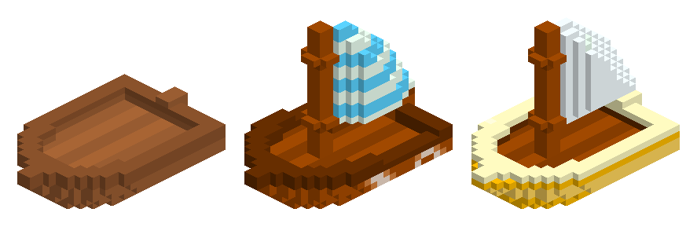

# Cube World Alternative Boats Mod

The game ships three boat models but only ever loads one of them. This mod puts
one of the other two in its place, so the boat you summon is drawn with a model
you otherwise never get to see.

*Left to right: `boat.cub`, `boat2.cub` and `boat3.cub`. The middle one is the
vanilla boat; the other two are what `AlternativeBoat1.dll` and
`AlternativeBoat3.dll` install.*

Only the model changes, the boat handles exactly as it always did.
The swap is local to your game, other players still see the normal boat.

This mod is for the **alpha** build of Cube World.

## Installation

Pick **one** DLL. Both change the same thing, so installing both does nothing
useful: whichever loads first wins and the other leaves it alone, and the mod
launcher does not load them in a predictable order.

* `AlternativeBoat1.dll` - the first boat model
* `AlternativeBoat3.dll` - the third boat model

Then:

* requires [coremaze Cube-World-Mod-Launcher](https://github.com/coremaze/Cube-World-Mod-Launcher/releases/tag/v1.5)
* unpack Mod Launcher in the game directory
* put the DLL into `Mods`
* start the game via `CubeModLauncher.exe`

## Compilation

Requires a compiler that targets 32-bit Windows. Run `make` in this directory
and specify the compiler as `CXX` variable if necessary (e.g.
`make CXX=i686-w64-mingw32-g++`). `make` builds both DLLs; name one of them to
build just that one.
